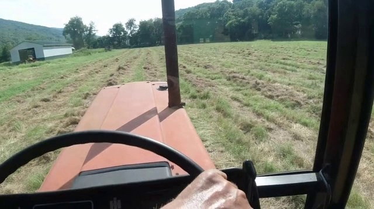
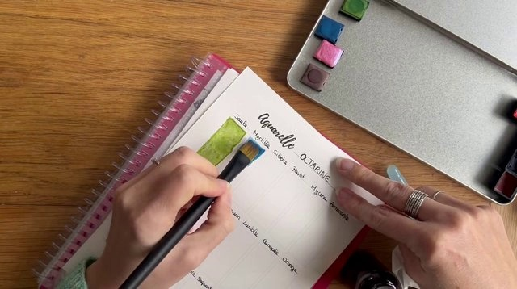
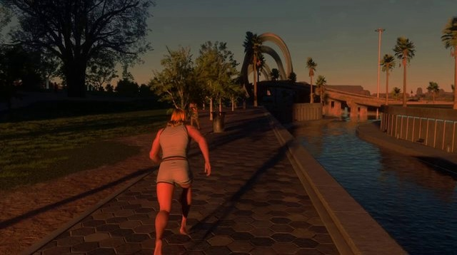
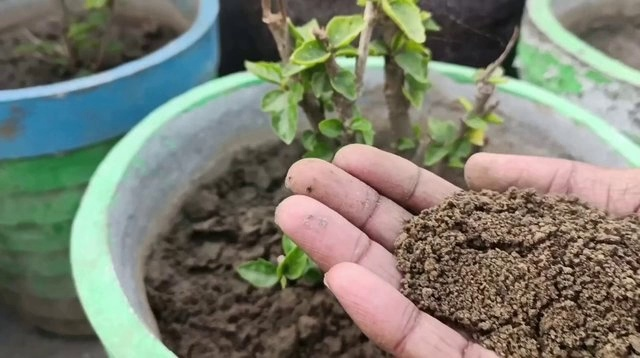
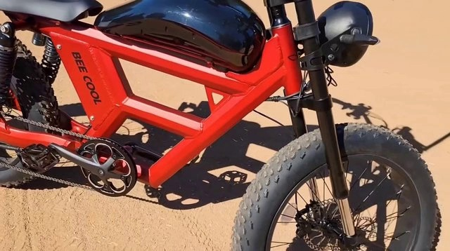

# I2V Action Duration Calibration

These are single actions excerpted from the complete I2V conversations. Their original offsets and surrounding segment boundaries are preserved. Every interval is at least two seconds; choose duration from the actual request rather than forcing one of these lengths.

## D3, Action 2

Reference: 

User:
```json
{
  "perspective_view": "third-person observer",
  "user_prompt": "An elevated third-person view of a gray seal floating upright in calm blue-green water, its head above the surface. For the first few seconds it stays nearly stationary, facing toward the camera while small ripples spread around its neck. It then lifts its head slightly higher out of the water and slowly turns it from facing forward to its left, coming into profile. It holds that leftward profile, gazing steadily in that direction while continuing to float upright, its whiskers spread forward and gentle rings rippling outward. Throughout, the camera holds a high downward angle and gradually zooms in, tightening toward the water surface so the pale stone ledge at the top of the frame exits view and the framing ends close on the surface, with small bubbles and gentle disturbances visible around the center. Real-world-footage visual style."
}
```

Segment: `00:00.000` to `00:10.000`. Excerpt duration: 2.4 seconds.

Action at its original segment offset:
```json
{
  "start_time": "00:03.600",
  "end_time": "00:06.000",
  "action_description": "<Action2><|Subject1|> lifts the head slightly higher above the water and slowly turns the head toward <|Subject1|>'s left into profile</Action2>."
}
```

## A4, Action 1

Reference: 

User:
```json
{
  "perspective_view": "first-person",
  "user_prompt": "Starting from the reference view inside the tractor cab, keep the first-person perspective as the operator grips the black steering wheel and drives forward along the cut hay rows, with the orange hood aligned to the field path. After a couple of seconds, move the right hand from the steering area toward the side control lever while still driving forward and directing attention toward the right side window. Continue operating the moving tractor while towing the green baler over the windrows, monitoring the implement through the rear-right window as the cab-mounted view rotates right across the side window to show the interior framing, a small wired control box with red indicator lights, and the large green baler behind. Keep the reveal of the control box and towed baler occurring as the view turns, not already established at the start. Maintain bright daylight and the forward path and rear implement centered as described."
}
```

Segment: `00:00.000` to `00:10.000`. Excerpt duration: 2.5 seconds.

Action at its original segment offset:
```json
{
  "start_time": "00:00.000",
  "end_time": "00:02.500",
  "action_description": "<Action1><|Subject1|>'s visible hand grips the steering wheel and makes small steering adjustments during off-camera operation of the forward-moving tractor</Action1>."
}
```

## A3, Action 1

Reference: 

User:
```json
{
  "perspective_view": "first-person",
  "user_prompt": "A first-person overhead view of my hands as I steady a watercolor notebook on a wooden table and paint a bright blue rectangular swatch next to an existing yellow-green sample. My left hand holds the page in place while my right hand uses the flat brush to begin short downward strokes at the upper edge of the blue swatch. I keep my left hand planted and make repeated vertical passes, extending the blue pigment downward beside the green rectangle. Then I continue layering and smoothing the blue with controlled back-and-forth strokes, widening and evening out the swatch while the page stays in place. Keep the framing tight on the notebook and paint tin with no significant camera movement."
}
```

Segment: `00:00.000` to `00:14.000`. Excerpt duration: 3 seconds.

Action at its original segment offset:
```json
{
  "start_time": "00:00.000",
  "end_time": "00:03.000",
  "action_description": "<Action1><|Subject1|>'s left hand holds the notebook page steady while <|Subject1|>'s right hand presses the flat brush into the upper edge of the blue swatch and begins short downward strokes</Action1>."
}
```

## A3, Action 2

Reference: 

User:
```json
{
  "perspective_view": "first-person",
  "user_prompt": "A first-person overhead view of my hands as I steady a watercolor notebook on a wooden table and paint a bright blue rectangular swatch next to an existing yellow-green sample. My left hand holds the page in place while my right hand uses the flat brush to begin short downward strokes at the upper edge of the blue swatch. I keep my left hand planted and make repeated vertical passes, extending the blue pigment downward beside the green rectangle. Then I continue layering and smoothing the blue with controlled back-and-forth strokes, widening and evening out the swatch while the page stays in place. Keep the framing tight on the notebook and paint tin with no significant camera movement."
}
```

Segment: `00:00.000` to `00:14.000`. Excerpt duration: 5 seconds.

Action at its original segment offset:
```json
{
  "start_time": "00:03.000",
  "end_time": "00:08.000",
  "action_description": "<Action2><|Subject1|>'s left hand stays planted on the page while <|Subject1|>'s right hand makes repeated vertical brush passes beside the existing green rectangle</Action2>."
}
```

## A3, Action 3

Reference: 

User:
```json
{
  "perspective_view": "first-person",
  "user_prompt": "A first-person overhead view of my hands as I steady a watercolor notebook on a wooden table and paint a bright blue rectangular swatch next to an existing yellow-green sample. My left hand holds the page in place while my right hand uses the flat brush to begin short downward strokes at the upper edge of the blue swatch. I keep my left hand planted and make repeated vertical passes, extending the blue pigment downward beside the green rectangle. Then I continue layering and smoothing the blue with controlled back-and-forth strokes, widening and evening out the swatch while the page stays in place. Keep the framing tight on the notebook and paint tin with no significant camera movement."
}
```

Segment: `00:00.000` to `00:14.000`. Excerpt duration: 6 seconds.

Action at its original segment offset:
```json
{
  "start_time": "00:08.000",
  "end_time": "00:14.000",
  "action_description": "<Action3><|Subject1|>'s right hand continues controlled back-and-forth brush strokes across the blue swatch while <|Subject1|>'s left hand maintains the page position</Action3>."
}
```

## C3, Action 1

Reference: 

User:
```json
{
  "perspective_view": "third-person",
  "user_prompt": "Follow a barefoot woman with reddish-blonde hair in a beige athletic outfit from behind at a steady chase distance as she runs continuously forward along a paved waterfront promenade at sunset, arms pumping, passing trees and a trash receptacle while heading toward the large arch structure ahead. Keep her centered in the frame throughout. In a video-game visual style, let the arch gradually grow nearer, with overhanging branches briefly crossing the foreground around the midpoint before clearing as the path opens again."
}
```

Segment: `00:00.000` to `00:09.000`. Excerpt duration: 9 seconds.

Action at its original segment offset:
```json
{
  "start_time": "00:00.000",
  "end_time": "00:09.000",
  "action_description": "<Action1><|Subject1|> runs continuously forward along the paved waterfront promenade, arms pumping at <|Subject1|>'s sides, passing trees and a trash receptacle while heading toward the large arch structure ahead</Action1>."
}
```

## A2, Action 1

Reference: 

User:
```json
{
  "perspective_view": "first-person",
  "user_prompt": "First-person view, real-world footage style. Start with a tight close-up on my cupped right hand — with slightly dirty fingers emerging from a dark red sleeve — holding a mound of brown granular fertilizer steadily above a potted shrub. Over the clip, slowly tilt and shift the open palm up, down, and side to side to display the material from slightly different angles, keeping the mound heaped and undisturbed, while the handheld camera gradually pulls back and widens the framing to reveal the surrounding pots, the shrub's full shape, and the concrete ground, with minor natural shake."
}
```

Segment: `00:00.000` to `00:13.000`. Excerpt duration: 13 seconds.

Action at its original segment offset:
```json
{
  "start_time": "00:00.000",
  "end_time": "00:13.000",
  "action_description": "<Action1><|Subject1|>'s right hand holds a cupped mound of brown granular fertilizer steadily above the potted plant, slowly shifting the open palm up, down, and side to side to display the material</Action1>."
}
```

## D1, Action 1

Reference: 

User:
```json
{
  "perspective_view": "third-person observer",
  "user_prompt": "Using the reference image as the opening frame, show the red BEE COOL electric fat-tire bike remaining stationary and parked upright on the sunlit tan dirt for the full 6 seconds — it does not move or roll. Over that time, have the camera arc smoothly around the parked bike from the side toward the front while gradually pushing in closer, passing the front wheel with its knobby fat tire and disc brake rotor, revealing the black front suspension fork with gold lower stanchions, the round matte-black headlight and bundled cables, then continue tilting and rising up the fork and tighten into an extreme close-up of the black handlebar, stem, control mounts, grips and brake levers against the pale sand. Keep a real-world-footage visual style."
}
```

Segment: `00:00.000` to `00:06.000`. Excerpt duration: 6 seconds.

Action at its original segment offset:
```json
{
  "start_time": "00:00.000",
  "end_time": "00:06.000",
  "action_description": "<Action1><|Subject1|> remains stationary and parked upright on the sandy ground throughout the segment</Action1>."
}
```
