# I2V User To Dense Caption Examples

Independent conversations using the same contract and media as the system prompt.

### Example A2: I2V initialization - gardener

This is an independent I2V conversation; do not inherit another example's world.

Reference image (attached visual input): 

#### Current Turn

User:
```json
{
  "perspective_view": "first-person",
  "user_prompt": "First-person view, real-world footage style. Start with a tight close-up on my cupped right hand — with slightly dirty fingers emerging from a dark red sleeve — holding a mound of brown granular fertilizer steadily above a potted shrub. Over the clip, slowly tilt and shift the open palm up, down, and side to side to display the material from slightly different angles, keeping the mound heaped and undisturbed, while the handheld camera gradually pulls back and widens the framing to reveal the surrounding pots, the shrub's full shape, and the concrete ground, with minor natural shake."
}
```

Assistant:
```json
{
  "perspective_view": "first-person",
  "Style": "real-world footage",
  "subject_list": [
    {
      "subject_id": "<|Subject1|>",
      "display_name": "gardener",
      "subject_attribute": "An adult gardener is visible only through a bare right hand with natural skin creases and soil-marked fingers above a plant pot. The head and torso are outside the frame. The gardener is embodied by the camera, and has the same first-person viewpoint as the camera throughout the whole video. Most of the gardener is not visible, and optionally only a small part of the gardener can be seen in the video."
    }
  ],
  "segments": [
    {
      "start_time": "00:00.000",
      "end_time": "00:13.000",
      "visual_description_long": "The opening image shows a compact outdoor container garden in daylight. A pale green round pot occupies the middle of the composition, containing uneven dark soil and a small woody shrub with short cut stems and fresh green leaves. A blue-rimmed pot sits behind it at the left, while another green pot and a dark textured container overlap in the upper background. The rims show scuffs and pale dirt deposits. Gray concrete is visible in the gaps between containers. Brown granular material is present in the foreground above the central pot. <Camera1>The handheld view gradually pulls back from the close foreground, revealing more pot rims, soil, lower stems, and concrete with mild natural shake</Camera1>.",
      "description_change": null,
      "contained_actions": [
        {
          "start_time": "00:00.000",
          "end_time": "00:13.000",
          "action_description": "<Action1><|Subject1|>'s right hand holds a cupped mound of brown granular fertilizer steadily above the potted plant, slowly shifting the open palm up, down, and side to side to display the material</Action1>."
        }
      ]
    }
  ]
}
```

### Example A3: I2V initialization - watercolor painter

This is an independent I2V conversation; do not inherit another example's world.

Reference image (attached visual input): 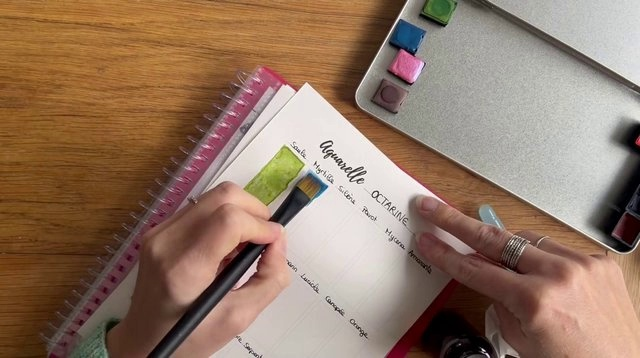

#### Current Turn

User:
```json
{
  "perspective_view": "first-person",
  "user_prompt": "A first-person overhead view of my hands as I steady a watercolor notebook on a wooden table and paint a bright blue rectangular swatch next to an existing yellow-green sample. My left hand holds the page in place while my right hand uses the flat brush to begin short downward strokes at the upper edge of the blue swatch. I keep my left hand planted and make repeated vertical passes, extending the blue pigment downward beside the green rectangle. Then I continue layering and smoothing the blue with controlled back-and-forth strokes, widening and evening out the swatch while the page stays in place. Keep the framing tight on the notebook and paint tin with no significant camera movement."
}
```

Assistant:
```json
{
  "perspective_view": "first-person",
  "Style": "real-world footage",
  "subject_list": [
    {
      "subject_id": "<|Subject1|>",
      "display_name": "watercolor painter",
      "subject_attribute": "An adult painter is visible through two light-skinned hands above a notebook. A dark-handled flat brush is held near the page, and silver rings are visible on the hand beside the paper. The head and torso are outside the frame. The watercolor painter is embodied by the camera, and has the same first-person viewpoint as the camera throughout the whole video. Most of the watercolor painter is not visible, and optionally only a small part of the watercolor painter can be seen in the video."
    }
  ],
  "segments": [
    {
      "start_time": "00:00.000",
      "end_time": "00:14.000",
      "visual_description_long": "A wooden tabletop forms the warm brown background of the reference image. An open spiral-bound watercolor notebook lies diagonally across the center, with a pink patterned cover peeking from beneath the white page. A yellow-green rectangular swatch and the beginnings of a blue test area are visible near handwritten pigment notes. An open metal paint tin occupies the upper-right area, with small pans in several distinct colors. The paper is matte and slightly textured, while the surrounding wood has a clear horizontal grain. Soft indoor light casts shallow shadows along the page and tin. During the requested painting sequence, the blue rectangle extends downward and becomes more evenly saturated beside the existing yellow-green sample.",
      "description_change": null,
      "contained_actions": [
        {
          "start_time": "00:00.000",
          "end_time": "00:03.000",
          "action_description": "<Action1><|Subject1|>'s left hand holds the notebook page steady while <|Subject1|>'s right hand presses the flat brush into the upper edge of the blue swatch and begins short downward strokes</Action1>."
        },
        {
          "start_time": "00:03.000",
          "end_time": "00:08.000",
          "action_description": "<Action2><|Subject1|>'s left hand stays planted on the page while <|Subject1|>'s right hand makes repeated vertical brush passes beside the existing green rectangle</Action2>."
        },
        {
          "start_time": "00:08.000",
          "end_time": "00:14.000",
          "action_description": "<Action3><|Subject1|>'s right hand continues controlled back-and-forth brush strokes across the blue swatch while <|Subject1|>'s left hand maintains the page position</Action3>."
        }
      ]
    }
  ]
}
```

### Example B1: I2V initialization - bearded man in gray hoodie

This is an independent I2V conversation; do not inherit another example's world.

Reference image (attached visual input): 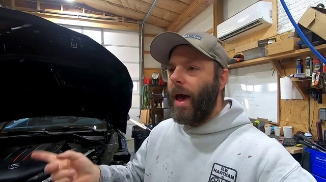

#### Current Turn

User:
```json
{
  "perspective_view": "second-person",
  "user_prompt": "Film a real-world-footage style selfie-style video of the bearded man in the gray hoodie standing in the garage beside the black car with its hood open, holding the camera at arm's length. Keep the handheld close chest-up framing with natural shake throughout. First, he speaks toward the lens while repeatedly gesturing with his right hand, pinching his fingers together and pointing. Then, still speaking, he raises his left hand with an open palm, glances upward and to the side, then looks back at the camera. Finally, he opens his mouth wide speaking emphatically, turns his head to look down into the engine bay, and points toward the engine with his right hand. Keep him as the dominant subject in frame, with his face centered at all times."
}
```

Assistant:
```json
{
  "perspective_view": "second-person",
  "Style": "real-world footage",
  "subject_list": [
    {
      "subject_id": "<|Subject1|>",
      "display_name": "bearded man in gray hoodie",
      "subject_attribute": "An adult man with a full dark beard wears a light gray hoodie and a gray baseball cap. The head and upper torso occupy the close selfie composition beside the raised car hood. The bearded man in gray hoodie is facing the camera and looking directly at the camera throughout the whole video. The bearded man in gray hoodie should be the dominant object in the video. If the camera lose the bearded man in gray hoodie or the bearded man in gray hoodie becomes too small in the video frame, the camera should quickly refocus on the bearded man in gray hoodie, and place the face or the front view of the bearded man in gray hoodie in the center of the video frame."
    }
  ],
  "segments": [
    {
      "start_time": "00:00.000",
      "end_time": "00:09.000",
      "visual_description_long": "The reference image shows a garage interior with exposed wooden ceiling beams and bright overhead lighting. A black car occupies the left side with its hood raised over a dark engine compartment. Plywood walls on the right support shelves containing boxes, bottles, and small workshop supplies. A white wall-mounted air-conditioning unit sits above a pale board and a cluttered work area. A dark tool chest and blue equipment are visible toward the right edge. Electrical cables and a blue hanging line cross the upper background. The garage door and shelving provide distinct layers of depth. <Camera1>The handheld view has mild natural shake and small angular changes within the same workshop area</Camera1>.",
      "description_change": null,
      "contained_actions": [
        {
          "start_time": "00:00.000",
          "end_time": "00:03.000",
          "action_description": "<Action1><|Subject1|> holds the camera at arm's length and speaks toward the lens while repeatedly gesturing with <|Subject1|>'s right hand, pinching <|Subject1|>'s fingers together and pointing</Action1>."
        },
        {
          "start_time": "00:03.000",
          "end_time": "00:06.000",
          "action_description": "<Action2><|Subject1|> continues speaking and raises <|Subject1|>'s left hand with an open palm while keeping <|Subject1|>'s face and gaze directed at the lens</Action2>."
        },
        {
          "start_time": "00:06.000",
          "end_time": "00:09.000",
          "action_description": "<Action3><|Subject1|> opens <|Subject1|>'s mouth wide while speaking emphatically and points toward the engine bay with <|Subject1|>'s right hand while maintaining direct gaze at the lens</Action3>."
        }
      ]
    }
  ]
}
```

### Example B2: I2V initialization - bearded hiker in rain jacket

This is an independent I2V conversation; do not inherit another example's world.

Reference image (attached visual input): 

#### Current Turn

User:
```json
{
  "perspective_view": "second-person",
  "user_prompt": "Using the reference image as the opening frame, generate real-world footage of the bearded hiker in the rain jacket holding the camera at arm's length in the rainy lakeside park. Keep him facing and looking toward the camera and dominant in frame throughout; if the camera loses him or he becomes too small, quickly refocus and center his face or front view. Over the first seven seconds, he walks forward across the wet grass while talking with his mouth open and periodically turning his head toward the lens. Around the four-second mark he continues walking past trees with orange autumn leaves, glancing between the camera and the path ahead as he speaks. The handheld selfie-style camera moves forward, slowly rotating and panning as it advances, gradually revealing the orange-leaved trees from the right and shifting the lake from the left background toward the rear of the frame."
}
```

Assistant:
```json
{
  "perspective_view": "second-person",
  "Style": "real-world footage",
  "subject_list": [
    {
      "subject_id": "<|Subject1|>",
      "display_name": "bearded hiker in rain jacket",
      "subject_attribute": "An adult man with a brown beard and longer brown hair wears a dark cap, a black rain jacket, and a backpack with red straps. An outstretched arm is partly visible in the close selfie composition. The bearded hiker in rain jacket is facing the camera and looking directly at the camera throughout the whole video. The bearded hiker in rain jacket should be the dominant object in the video. If the camera lose the bearded hiker in rain jacket or the bearded hiker in rain jacket becomes too small in the video frame, the camera should quickly refocus on the bearded hiker in rain jacket, and place the face or the front view of the bearded hiker in rain jacket in the center of the video frame."
    }
  ],
  "segments": [
    {
      "start_time": "00:00.000",
      "end_time": "00:07.000",
      "visual_description_long": "The reference image opens in a damp lakeside park under muted overcast light. A green lawn scattered with fallen leaves fills the foreground and right side. Behind it, a gray paved parking area with pale wheel stops runs beside a calm lake. Dark vertical posts mark the path edge, and a small waterside structure is visible at the left distance. Trees with brown and orange foliage stand across the grass, with a wooded shoreline beyond the water. The surfaces look wet and the colors subdued by cloud cover. <Camera1>The handheld view advances through the lawn with small rotations that progressively bring orange-leaved branches overhead and shift the lake farther into the background</Camera1>.",
      "description_change": null,
      "contained_actions": [
        {
          "start_time": "00:00.000",
          "end_time": "00:04.000",
          "action_description": "<Action1><|Subject1|> walks forward across the rainy grass while holding the camera at arm's length and talking with <|Subject1|>'s mouth open, keeping <|Subject1|>'s face and gaze directed at the lens</Action1>."
        },
        {
          "start_time": "00:04.000",
          "end_time": "00:07.000",
          "action_description": "<Action2><|Subject1|> continues walking past trees with orange autumn leaves while speaking and maintaining direct gaze at the camera</Action2>."
        }
      ]
    }
  ]
}
```

### Example C2: I2V initialization - white-haired armored swordsman

This is an independent I2V conversation; do not inherit another example's world.

Reference image (attached visual input): 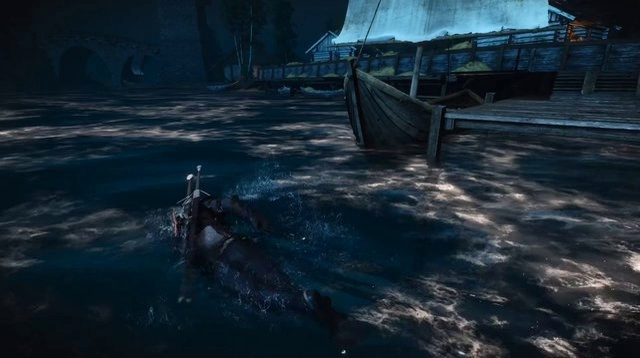

#### Current Turn

User:
```json
{
  "perspective_view": "third-person",
  "user_prompt": "Using the reference image as the starting frame, follow the white-haired armored swordsman from a close rear over-the-shoulder view as he swims forward through the dark harbor water with steady arm strokes, kicking up splashes while approaching the wooden sailboat moored near the dock. Over the next several seconds, keep him centered as he swims alongside the sailboat's hull, passing its bow and mast while continuing to stroke through the shimmering water. Then let him swim on past the sailboat toward the row of moored rowboats and the wooden pier, maintaining a steady prone swimming posture with rhythmic arm movements. The camera tracks forward over the water at low height, gradually panning and arcing around the moored sailboat, then continues orbiting past its hull and sweeps left to reveal the row of docked rowboats and the wooden pier structures ahead."
}
```

Assistant:
```json
{
  "perspective_view": "third-person follow",
  "Style": "video game",
  "subject_list": [
    {
      "subject_id": "<|Subject1|>",
      "display_name": "white-haired armored swordsman",
      "subject_attribute": "A white-haired game character is partly immersed in harbor water, with a dark armored upper back and sword handles protruding behind the shoulders. The lower body is submerged. The camera is placed behind the white-haired armored swordsman, and follows the white-haired armored swordsman throughout the whole video. The camera is tracking the white-haired armored swordsman and the white-haired armored swordsman should be placed in the center of the video."
    }
  ],
  "segments": [
    {
      "start_time": "00:00.000",
      "end_time": "00:12.000",
      "visual_description_long": "A dark harbor fills the opening image with blue-black water carrying irregular silver reflections. A weathered wooden boat lies to the right, with its raised bow and interior planks close to the water. Elevated docks, thick posts, railings, and wooden buildings form the distant shoreline. The roofs and walls are dimly lit in cool nighttime tones, with small warmer highlights near the structures. The water has soft ripples rather than a flat mirrored surface. <Camera1>The low view advances over the water, gradually arcing past the nearby sailboat and its hull</Camera1>. <Camera2>The view continues leftward toward additional moored rowboats and the wooden pier, revealing their spacing progressively</Camera2>.",
      "description_change": null,
      "contained_actions": [
        {
          "start_time": "00:00.000",
          "end_time": "00:04.000",
          "action_description": "<Action1><|Subject1|> swims forward through the dark water with steady arm strokes while approaching the wooden sailboat moored near the dock</Action1>."
        },
        {
          "start_time": "00:04.000",
          "end_time": "00:08.000",
          "action_description": "<Action2><|Subject1|> swims alongside the hull of the large wooden sailboat, passing the bow and mast with rhythmic arm strokes</Action2>."
        },
        {
          "start_time": "00:08.000",
          "end_time": "00:12.000",
          "action_description": "<Action3><|Subject1|> swims past the sailboat toward the row of moored rowboats and the wooden pier, maintaining a steady prone swimming posture with rhythmic arm movements</Action3>."
        }
      ]
    }
  ]
}
```

### Example D1: I2V initialization - red BEE COOL electric fat-tire bike

This is an independent I2V conversation; do not inherit another example's world.

Reference image (attached visual input): 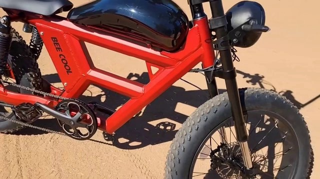

#### Current Turn

User:
```json
{
  "perspective_view": "third-person observer",
  "user_prompt": "Using the reference image as the opening frame, show the red BEE COOL electric fat-tire bike remaining stationary and parked upright on the sunlit tan dirt for the full 6 seconds — it does not move or roll. Over that time, have the camera arc smoothly around the parked bike from the side toward the front while gradually pushing in closer, passing the front wheel with its knobby fat tire and disc brake rotor, revealing the black front suspension fork with gold lower stanchions, the round matte-black headlight and bundled cables, then continue tilting and rising up the fork and tighten into an extreme close-up of the black handlebar, stem, control mounts, grips and brake levers against the pale sand. Keep a real-world-footage visual style."
}
```

Assistant:
```json
{
  "perspective_view": "third-person observer",
  "Style": "real-world footage",
  "subject_list": [
    {
      "subject_id": "<|Subject1|>",
      "display_name": "red BEE COOL electric fat-tire bike",
      "subject_attribute": "A red electric fat-tire bicycle has a glossy black battery cover, red frame, black fork, round headlight, and a large knobby front tire. The saddle and rear wheel are partly outside the initial close composition. The camera films the red BEE COOL electric fat-tire bike from an external position, and the red BEE COOL electric fat-tire bike is visible in the video. The framing of the video from the camera is independent of the red BEE COOL electric fat-tire bike, and does not follow the movement of the red BEE COOL electric fat-tire bike."
    }
  ],
  "segments": [
    {
      "start_time": "00:00.000",
      "end_time": "00:06.000",
      "visual_description_long": "Flat tan dirt covers the opening background, with fine granular texture and scattered tiny marks. Bright direct sunlight gives the level dry surface a warm pale color. Crisp dark shadows stretch across the lower ground, while smaller variations in the sandy texture remain visible between them. The close initial composition contains no building, fence, or tree line. The same open dirt surface stays behind the requested inspection, with the ground texture becoming less distinct in the tighter crop. <Camera1>The view arcs from the side toward the front and moves closer along the ground-level work area</Camera1>. <Camera2>The view then rises and tilts upward into a tighter inspection angle, leaving only pale sand behind the close foreground</Camera2>.",
      "description_change": null,
      "contained_actions": [
        {
          "start_time": "00:00.000",
          "end_time": "00:06.000",
          "action_description": "<Action1><|Subject1|> remains stationary and parked upright on the sandy ground throughout the segment</Action1>."
        }
      ]
    }
  ]
}
```

### Example E3: I2V text continuation - gardener

This is an independent I2V conversation; do not inherit another example's world.

Reference image (attached visual input): 

#### Prior Turn 1

User:
```json
{
  "perspective_view": "first-person",
  "user_prompt": "First-person view, real-world footage style. Start with a tight close-up on my cupped right hand — with slightly dirty fingers emerging from a dark red sleeve — holding a mound of brown granular fertilizer steadily above a potted shrub. Over the clip, slowly tilt and shift the open palm up, down, and side to side to display the material from slightly different angles, keeping the mound heaped and undisturbed, while the handheld camera gradually pulls back and widens the framing to reveal the surrounding pots, the shrub's full shape, and the concrete ground, with minor natural shake."
}
```

Assistant:
```json
{
  "perspective_view": "first-person",
  "Style": "real-world footage",
  "subject_list": [
    {
      "subject_id": "<|Subject1|>",
      "display_name": "gardener",
      "subject_attribute": "An adult gardener is visible only through a bare right hand with natural skin creases and soil-marked fingers above a plant pot. The head and torso are outside the frame. The gardener is embodied by the camera, and has the same first-person viewpoint as the camera throughout the whole video. Most of the gardener is not visible, and optionally only a small part of the gardener can be seen in the video."
    }
  ],
  "segments": [
    {
      "start_time": "00:00.000",
      "end_time": "00:13.000",
      "visual_description_long": "The opening image shows a compact outdoor container garden in daylight. A pale green round pot occupies the middle of the composition, containing uneven dark soil and a small woody shrub with short cut stems and fresh green leaves. A blue-rimmed pot sits behind it at the left, while another green pot and a dark textured container overlap in the upper background. The rims show scuffs and pale dirt deposits. Gray concrete is visible in the gaps between containers. Brown granular material is present in the foreground above the central pot. <Camera1>The handheld view gradually pulls back from the close foreground, revealing more pot rims, soil, lower stems, and concrete with mild natural shake</Camera1>.",
      "description_change": null,
      "contained_actions": [
        {
          "start_time": "00:00.000",
          "end_time": "00:13.000",
          "action_description": "<Action1><|Subject1|>'s right hand holds a cupped mound of brown granular fertilizer steadily above the potted plant, slowly shifting the open palm up, down, and side to side to display the material</Action1>."
        }
      ]
    }
  ]
}
```

Observed generated segment (ordered first / middle / last frames):

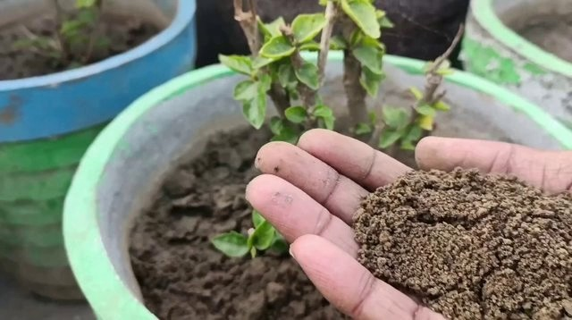
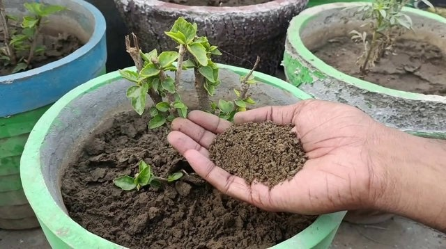
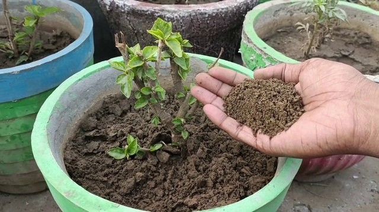

#### Current Turn

User:
```json
{
  "subsequent_text_prompt": "Have the camera zoom in closer on gardener's hands, which keeps the fertilizer cupped, then bring the other hand in to pinch and crumble the granules between thumb and fingers."
}
```

Assistant:
```json
{
  "segments": [
    {
      "start_time": "00:13.000",
      "end_time": "00:28.000",
      "visual_description_long": null,
      "description_change": "Compared to the previous segment, the visible scene, background, and other-object layout remain unchanged. <Camera1>The view pushes in smoothly toward the brown granular material, narrowing the visible garden to a close texture study while the surrounding pots progressively leave the crop</Camera1>.",
      "contained_actions": [
        {
          "start_time": "00:13.000",
          "end_time": "00:21.700",
          "action_description": "<Action1><|Subject1|>'s right hand keeps the brown fertilizer heaped in the open palm above the pot</Action1>."
        },
        {
          "start_time": "00:21.700",
          "end_time": "00:28.000",
          "action_description": "<Action2><|Subject1|>'s other hand enters from the frame edge and pinches, rubs, and crumbles small portions of the granules between thumb and fingers</Action2>."
        }
      ]
    }
  ]
}
```

### Example E7: I2V text continuation - bearded hiker in rain jacket

This is an independent I2V conversation; do not inherit another example's world.

Reference image (attached visual input): 

#### Prior Turn 1

User:
```json
{
  "perspective_view": "second-person",
  "user_prompt": "Using the reference image as the opening frame, generate real-world footage of the bearded hiker in the rain jacket holding the camera at arm's length in the rainy lakeside park. Keep him facing and looking toward the camera and dominant in frame throughout; if the camera loses him or he becomes too small, quickly refocus and center his face or front view. Over the first seven seconds, he walks forward across the wet grass while talking with his mouth open and periodically turning his head toward the lens. Around the four-second mark he continues walking past trees with orange autumn leaves, glancing between the camera and the path ahead as he speaks. The handheld selfie-style camera moves forward, slowly rotating and panning as it advances, gradually revealing the orange-leaved trees from the right and shifting the lake from the left background toward the rear of the frame."
}
```

Assistant:
```json
{
  "perspective_view": "second-person",
  "Style": "real-world footage",
  "subject_list": [
    {
      "subject_id": "<|Subject1|>",
      "display_name": "bearded hiker in rain jacket",
      "subject_attribute": "An adult man with a brown beard and longer brown hair wears a dark cap, a black rain jacket, and a backpack with red straps. An outstretched arm is partly visible in the close selfie composition. The bearded hiker in rain jacket is facing the camera and looking directly at the camera throughout the whole video. The bearded hiker in rain jacket should be the dominant object in the video. If the camera lose the bearded hiker in rain jacket or the bearded hiker in rain jacket becomes too small in the video frame, the camera should quickly refocus on the bearded hiker in rain jacket, and place the face or the front view of the bearded hiker in rain jacket in the center of the video frame."
    }
  ],
  "segments": [
    {
      "start_time": "00:00.000",
      "end_time": "00:07.000",
      "visual_description_long": "The reference image opens in a damp lakeside park under muted overcast light. A green lawn scattered with fallen leaves fills the foreground and right side. Behind it, a gray paved parking area with pale wheel stops runs beside a calm lake. Dark vertical posts mark the path edge, and a small waterside structure is visible at the left distance. Trees with brown and orange foliage stand across the grass, with a wooded shoreline beyond the water. The surfaces look wet and the colors subdued by cloud cover. <Camera1>The handheld view advances through the lawn with small rotations that progressively bring orange-leaved branches overhead and shift the lake farther into the background</Camera1>.",
      "description_change": null,
      "contained_actions": [
        {
          "start_time": "00:00.000",
          "end_time": "00:04.000",
          "action_description": "<Action1><|Subject1|> walks forward across the rainy grass while holding the camera at arm's length and talking with <|Subject1|>'s mouth open, keeping <|Subject1|>'s face and gaze directed at the lens</Action1>."
        },
        {
          "start_time": "00:04.000",
          "end_time": "00:07.000",
          "action_description": "<Action2><|Subject1|> continues walking past trees with orange autumn leaves while speaking and maintaining direct gaze at the camera</Action2>."
        }
      ]
    }
  ]
}
```

Observed generated segment (ordered first / middle / last frames):

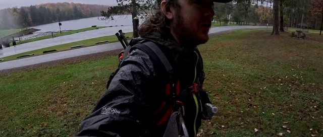
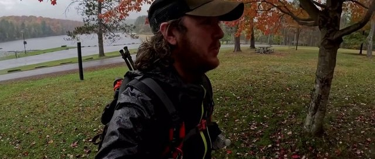
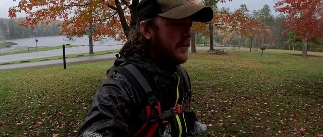

#### Prior Turn 2

User:
```json
{
  "camera_control": {
    "durationMs": 10000,
    "keyEvents": [
      {
        "t": 0.0,
        "code": "KeyS",
        "pressed": true
      },
      {
        "t": 291.6666666666667,
        "code": "KeyD",
        "pressed": true
      },
      {
        "t": 708.3333333333334,
        "code": "KeyD",
        "pressed": false
      },
      {
        "t": 791.6666666666666,
        "code": "KeyD",
        "pressed": true
      },
      {
        "t": 833.3333333333334,
        "code": "KeyD",
        "pressed": false
      },
      {
        "t": 1000.0,
        "code": "KeyD",
        "pressed": true
      },
      {
        "t": 1083.3333333333333,
        "code": "KeyD",
        "pressed": false
      },
      {
        "t": 1583.3333333333333,
        "code": "KeyD",
        "pressed": true
      },
      {
        "t": 1625.0,
        "code": "KeyD",
        "pressed": false
      },
      {
        "t": 1708.3333333333333,
        "code": "KeyD",
        "pressed": true
      },
      {
        "t": 1750.0,
        "code": "KeyD",
        "pressed": false
      },
      {
        "t": 5375.0,
        "code": "KeyD",
        "pressed": true
      },
      {
        "t": 5416.666666666667,
        "code": "KeyD",
        "pressed": false
      },
      {
        "t": 5458.333333333333,
        "code": "KeyD",
        "pressed": true
      },
      {
        "t": 5666.666666666667,
        "code": "KeyD",
        "pressed": false
      },
      {
        "t": 6750.0,
        "code": "KeyD",
        "pressed": true
      },
      {
        "t": 6791.666666666667,
        "code": "KeyD",
        "pressed": false
      },
      {
        "t": 7916.666666666667,
        "code": "KeyD",
        "pressed": true
      },
      {
        "t": 8208.333333333334,
        "code": "KeyD",
        "pressed": false
      },
      {
        "t": 9208.333333333334,
        "code": "KeyD",
        "pressed": true
      },
      {
        "t": 9541.666666666666,
        "code": "KeyD",
        "pressed": false
      },
      {
        "t": 9583.333333333334,
        "code": "KeyD",
        "pressed": true
      },
      {
        "t": 9750.0,
        "code": "KeyD",
        "pressed": false
      },
      {
        "t": 10000.0,
        "code": "KeyS",
        "pressed": false
      }
    ]
  }
}
```

Assistant:
```json
{
  "segments": [
    {
      "start_time": "00:07.000",
      "end_time": "00:17.000",
      "visual_description_long": null,
      "description_change": "Compared to the previous segment, the visible scene and composition transition continuously.",
      "contained_actions": []
    }
  ]
}
```

Observed generated segment (ordered first / middle / last frames):

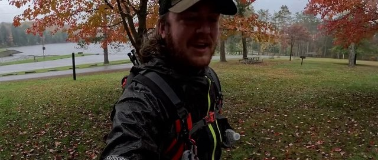
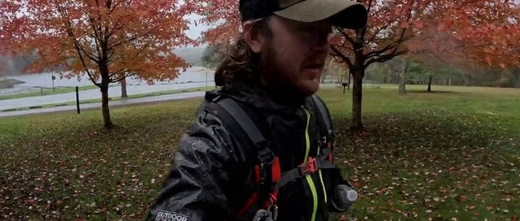
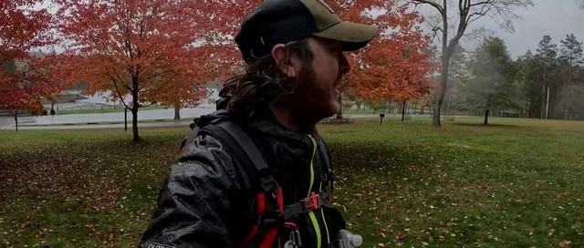

#### Current Turn

User:
```json
{
  "subsequent_text_prompt": "Walk slowly over the open rainy lawn with the camera at arm's length, continuing to talk and glance toward the lens. Slow to a near standstill, survey the trees and grass on both sides, briefly face the camera while speaking, then look back over the shoulder toward the treeline. Keep autumn trees mainly on the left and the open lawn and pines on the right."
}
```

Assistant:
```json
{
  "segments": [
    {
      "start_time": "00:17.000",
      "end_time": "00:28.595",
      "visual_description_long": null,
      "description_change": "Compared to the previous segment, the lawn opens more widely on the right, while the denser autumn trees remain mostly to the left. Scattered pines and a distant shelter appear near the far tree line beneath the same gray sky. <Camera1>The handheld view slows its forward movement and rotates gently from side to side across the grass and tree line</Camera1>.",
      "contained_actions": [
        {
          "start_time": "00:17.000",
          "end_time": "00:23.000",
          "action_description": "<Action1><|Subject1|> continues walking slowly across the grass while holding the camera at arm's length and talking with <|Subject1|>'s mouth open, maintaining direct gaze at the lens</Action1>."
        },
        {
          "start_time": "00:23.000",
          "end_time": "00:28.595",
          "action_description": "<Action2><|Subject1|> slows to a near standstill while speaking, keeping <|Subject1|>'s face and gaze directed at the lens</Action2>."
        }
      ]
    }
  ]
}
```

### Example E8: I2V text continuation - white-haired armored swordsman

This is an independent I2V conversation; do not inherit another example's world.

Reference image (attached visual input): 

#### Prior Turn 1

User:
```json
{
  "perspective_view": "third-person",
  "user_prompt": "Using the reference image as the starting frame, follow the white-haired armored swordsman from a close rear over-the-shoulder view as he swims forward through the dark harbor water with steady arm strokes, kicking up splashes while approaching the wooden sailboat moored near the dock. Over the next several seconds, keep him centered as he swims alongside the sailboat's hull, passing its bow and mast while continuing to stroke through the shimmering water. Then let him swim on past the sailboat toward the row of moored rowboats and the wooden pier, maintaining a steady prone swimming posture with rhythmic arm movements. The camera tracks forward over the water at low height, gradually panning and arcing around the moored sailboat, then continues orbiting past its hull and sweeps left to reveal the row of docked rowboats and the wooden pier structures ahead."
}
```

Assistant:
```json
{
  "perspective_view": "third-person follow",
  "Style": "video game",
  "subject_list": [
    {
      "subject_id": "<|Subject1|>",
      "display_name": "white-haired armored swordsman",
      "subject_attribute": "A white-haired game character is partly immersed in harbor water, with a dark armored upper back and sword handles protruding behind the shoulders. The lower body is submerged. The camera is placed behind the white-haired armored swordsman, and follows the white-haired armored swordsman throughout the whole video. The camera is tracking the white-haired armored swordsman and the white-haired armored swordsman should be placed in the center of the video."
    }
  ],
  "segments": [
    {
      "start_time": "00:00.000",
      "end_time": "00:12.000",
      "visual_description_long": "A dark harbor fills the opening image with blue-black water carrying irregular silver reflections. A weathered wooden boat lies to the right, with its raised bow and interior planks close to the water. Elevated docks, thick posts, railings, and wooden buildings form the distant shoreline. The roofs and walls are dimly lit in cool nighttime tones, with small warmer highlights near the structures. The water has soft ripples rather than a flat mirrored surface. <Camera1>The low view advances over the water, gradually arcing past the nearby sailboat and its hull</Camera1>. <Camera2>The view continues leftward toward additional moored rowboats and the wooden pier, revealing their spacing progressively</Camera2>.",
      "description_change": null,
      "contained_actions": [
        {
          "start_time": "00:00.000",
          "end_time": "00:04.000",
          "action_description": "<Action1><|Subject1|> swims forward through the dark water with steady arm strokes while approaching the wooden sailboat moored near the dock</Action1>."
        },
        {
          "start_time": "00:04.000",
          "end_time": "00:08.000",
          "action_description": "<Action2><|Subject1|> swims alongside the hull of the large wooden sailboat, passing the bow and mast with rhythmic arm strokes</Action2>."
        },
        {
          "start_time": "00:08.000",
          "end_time": "00:12.000",
          "action_description": "<Action3><|Subject1|> swims past the sailboat toward the row of moored rowboats and the wooden pier, maintaining a steady prone swimming posture with rhythmic arm movements</Action3>."
        }
      ]
    }
  ]
}
```

Observed generated segment (ordered first / middle / last frames):


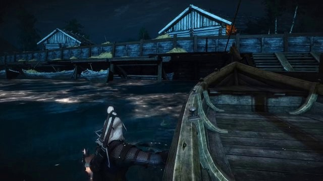
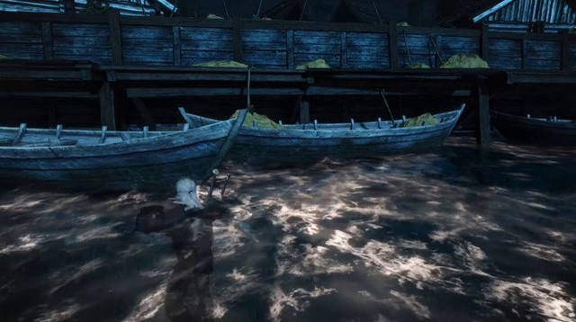

#### Current Turn

User:
```json
{
  "subsequent_text_prompt": "Continue the scene as the open harbor with the large sailboat gives way to a shallower shoreline beneath elevated wooden docks, where moored rowboats with hay cargo are gradually replaced by a muddy bank with a wooden ramp, a burning torch on a post, and a grassy village of log cabins with thatched and shingled roofs lit by warm lanterns. The white-haired armored swordsman continues swimming forward past the moored rowboats toward the shoreline beneath the elevated wooden dock. He then wades upright out of the shallow water onto the muddy bank, runs past a burning torch post, and vaults over the wooden plank wall into the grassy village. After that he runs through the tall grass between the log cabins, following a dirt path toward a thatched-roof hut. He climbs onto the sloped thatched roof of the hut, scrambles up to the ridge, and stands atop it overlooking the village. Throughout this, the camera continues tracking forward at low height over the water, passing the rowboats and approaching the shore, then follows at close range up the muddy bank, over the wooden plank wall, and through the grassy paths between the cabins, and finally rises and tilts downward as the framing ascends onto a thatched rooftop, then holds a high rear view overlooking the torch-lit village paths and surrounding cabins."
}
```

Assistant:
```json
{
  "segments": [
    {
      "start_time": "00:12.000",
      "end_time": "00:22.733",
      "visual_description_long": null,
      "description_change": "Compared to the previous segment, the harbor route reaches shallower water beneath raised docks, then a muddy bank, a timber ramp, and torch-lit village paths between wooden cabins. Wooden roof edges and low plank walls become clearer along the route. <Camera1>The low trailing view advances past the rowboats toward the shoreline, then rises over the bank and continues along the grassy paths</Camera1>. <Camera2>The trailing view ascends over a thatched roof and tilts down toward the surrounding cabins and illuminated paths</Camera2>.",
      "contained_actions": [
        {
          "start_time": "00:12.000",
          "end_time": "00:16.000",
          "action_description": "<Action1><|Subject1|> continues swimming forward past the moored rowboats toward the shoreline beneath the elevated wooden dock</Action1>."
        },
        {
          "start_time": "00:16.000",
          "end_time": "00:18.100",
          "action_description": "<Action2><|Subject1|> wades upright out of the shallow water onto the muddy bank, runs past a burning torch post, and vaults over the wooden plank wall into the grassy village</Action2>."
        },
        {
          "start_time": "00:18.100",
          "end_time": "00:20.667",
          "action_description": "<Action3><|Subject1|> runs through the tall grass between the log cabins, following a dirt path toward a thatched-roof hut</Action3>."
        },
        {
          "start_time": "00:20.667",
          "end_time": "00:22.733",
          "action_description": "<Action4><|Subject1|> climbs onto the sloped thatched roof of the hut, scrambles up to the ridge, and stands atop it overlooking the village</Action4>."
        }
      ]
    }
  ]
}
```

### Example F9: I2V camera control - white-flowering tree

This is an independent I2V conversation; do not inherit another example's world.

Reference image (attached visual input): 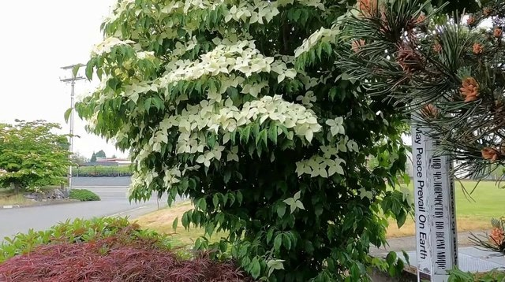

#### Prior Turn 1

User:
```json
{
  "perspective_view": "third-person observer",
  "user_prompt": "Generate a real-world-footage shot of the large white-flowering deciduous tree standing at the grassy roadside verge. Keep the tree in place at the verge, its dense clusters of white four-petaled flowers over dark green leaves filling the center of the frame, with the branches swaying subtly in the air. Over the 14 seconds, slowly pan leftward past the nearby peace pole so it exits the right side of the frame, then continue drifting left with a subtle push toward the white blossoms, gradually filling more of the frame with the flowering canopy. Keep the background activity of cars driving through the distant intersection under the bright overcast light."
}
```

Assistant:
```json
{
  "perspective_view": "third-person observer",
  "Style": "real-world footage",
  "subject_list": [
    {
      "subject_id": "<|Subject1|>",
      "display_name": "white-flowering tree",
      "subject_attribute": "A dense leafy tree has pale white flower-like bracts with dark green foliage beneath. The canopy fills most of the opening view, with the trunk obscured by foliage. The camera films the white-flowering tree from an external position, and the white-flowering tree is visible in the video. The framing of the video from the camera is independent of the white-flowering tree, and does not follow the movement of the white-flowering tree."
    }
  ],
  "segments": [
    {
      "start_time": "00:00.000",
      "end_time": "00:14.000",
      "visual_description_long": "The opening image shows a roadside planting area with low reddish-purple and green shrubs along the foreground. A yellow-green strip of grass separates the planting bed from gray pavement and a curved intersection beyond. Another small tree, utility poles, and low distant structures appear across the road. A tall white peace pole stands on the right, partly overlapped by pine branches and small brown cones. Diffuse overcast light keeps the roadside colors soft and evenly lit. Distant cars continue through the intersection as requested. <Camera1>The view pans gently left past the pole so it exits the right edge</Camera1>. <Camera2>The view continues with a modest push toward the planting area while the distant intersection remains visible through the gaps</Camera2>.",
      "description_change": null,
      "contained_actions": [
        {
          "start_time": "00:00.000",
          "end_time": "00:14.000",
          "action_description": "<Action1><|Subject1|> remains rooted in place at the roadside verge while <|Subject1|>'s branches sway subtly in the air</Action1>."
        }
      ]
    }
  ]
}
```

Observed generated segment (ordered first / middle / last frames):


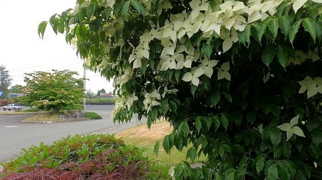
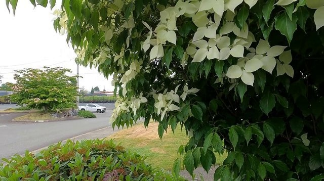

#### Current Turn

User:
```json
{
  "camera_control": {
    "durationMs": 15000,
    "keyEvents": [
      {
        "t": 10541.666666666666,
        "code": "ArrowDown",
        "pressed": true
      },
      {
        "t": 10583.333333333334,
        "code": "ArrowDown",
        "pressed": false
      },
      {
        "t": 10708.333333333334,
        "code": "ArrowDown",
        "pressed": true
      },
      {
        "t": 10750.0,
        "code": "ArrowDown",
        "pressed": false
      },
      {
        "t": 10875.0,
        "code": "ArrowDown",
        "pressed": true
      },
      {
        "t": 10916.666666666666,
        "code": "ArrowDown",
        "pressed": false
      },
      {
        "t": 11041.666666666666,
        "code": "ArrowDown",
        "pressed": true
      },
      {
        "t": 11083.333333333334,
        "code": "ArrowDown",
        "pressed": false
      },
      {
        "t": 11208.333333333334,
        "code": "ArrowDown",
        "pressed": true
      },
      {
        "t": 11250.0,
        "code": "ArrowDown",
        "pressed": false
      },
      {
        "t": 11375.0,
        "code": "ArrowDown",
        "pressed": true
      },
      {
        "t": 11416.666666666666,
        "code": "ArrowDown",
        "pressed": false
      },
      {
        "t": 11541.666666666666,
        "code": "ArrowDown",
        "pressed": true
      },
      {
        "t": 11583.333333333334,
        "code": "ArrowDown",
        "pressed": false
      },
      {
        "t": 11708.333333333334,
        "code": "ArrowDown",
        "pressed": true
      },
      {
        "t": 11750.0,
        "code": "ArrowDown",
        "pressed": false
      },
      {
        "t": 11875.0,
        "code": "ArrowDown",
        "pressed": true
      },
      {
        "t": 11916.666666666666,
        "code": "ArrowDown",
        "pressed": false
      },
      {
        "t": 12041.666666666666,
        "code": "ArrowDown",
        "pressed": true
      },
      {
        "t": 12083.333333333334,
        "code": "ArrowDown",
        "pressed": false
      },
      {
        "t": 12208.333333333334,
        "code": "ArrowDown",
        "pressed": true
      },
      {
        "t": 12250.0,
        "code": "ArrowDown",
        "pressed": false
      },
      {
        "t": 12375.0,
        "code": "ArrowDown",
        "pressed": true
      },
      {
        "t": 12416.666666666666,
        "code": "ArrowDown",
        "pressed": false
      },
      {
        "t": 12541.666666666666,
        "code": "ArrowDown",
        "pressed": true
      },
      {
        "t": 12583.333333333334,
        "code": "ArrowDown",
        "pressed": false
      },
      {
        "t": 12708.333333333334,
        "code": "ArrowDown",
        "pressed": true
      },
      {
        "t": 12750.0,
        "code": "ArrowDown",
        "pressed": false
      },
      {
        "t": 12875.0,
        "code": "ArrowDown",
        "pressed": true
      },
      {
        "t": 12916.666666666666,
        "code": "ArrowDown",
        "pressed": false
      }
    ]
  }
}
```

Assistant:
```json
{
  "segments": [
    {
      "start_time": "00:14.000",
      "end_time": "00:29.000",
      "visual_description_long": null,
      "description_change": "Compared to the previous segment, the established reddish-purple and green ground-cover shrubs occupy more of the lower scene, together with the pale grassy verge. The paved intersection remains farther behind the planting bed under the same diffuse daylight.",
      "contained_actions": []
    }
  ]
}
```
